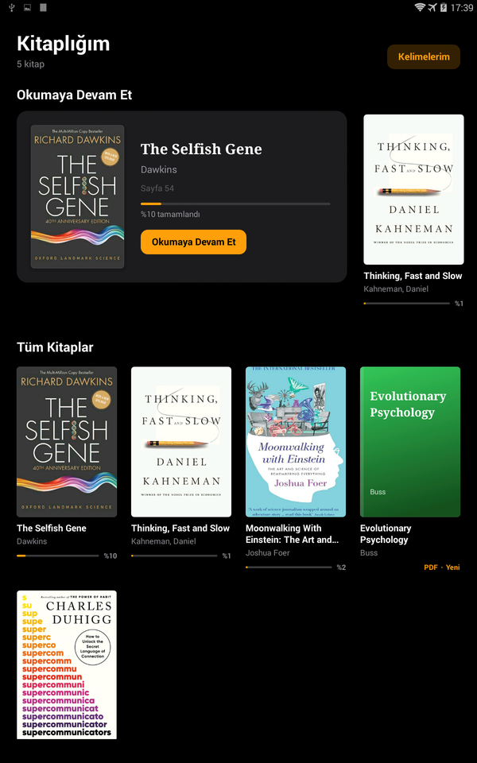
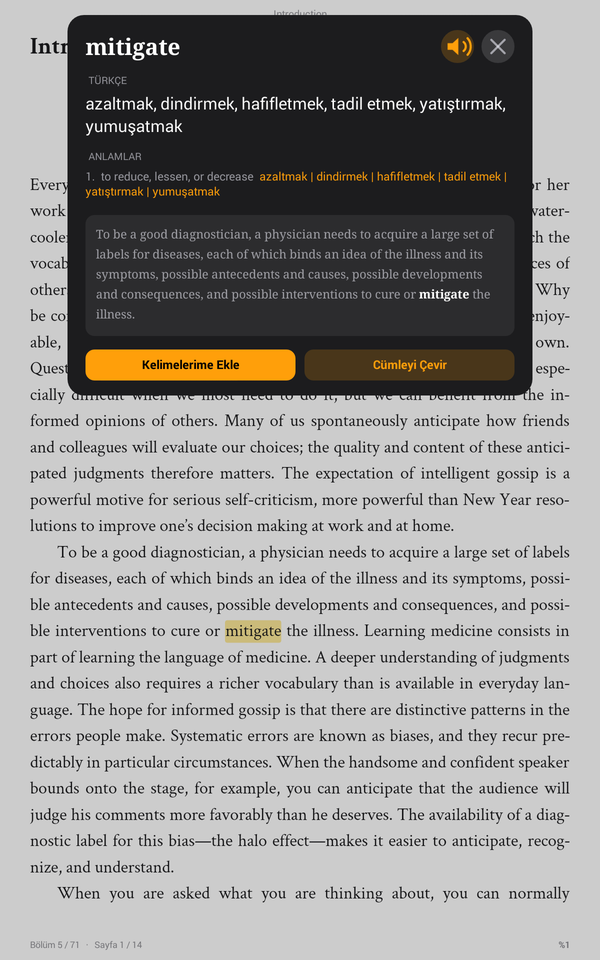
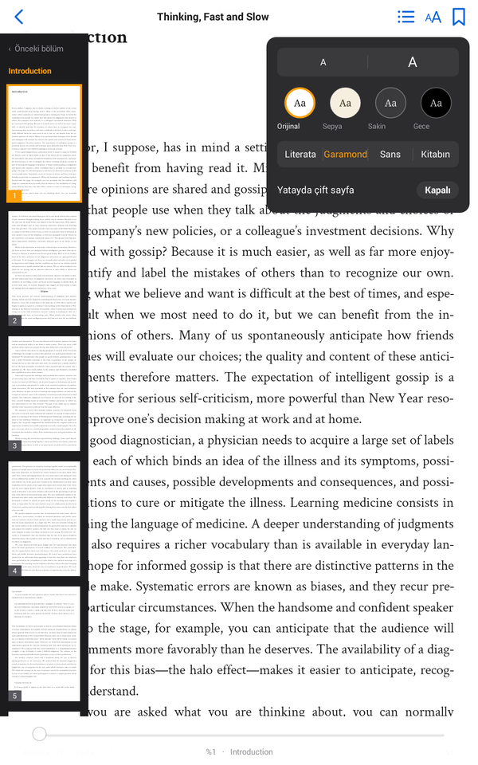
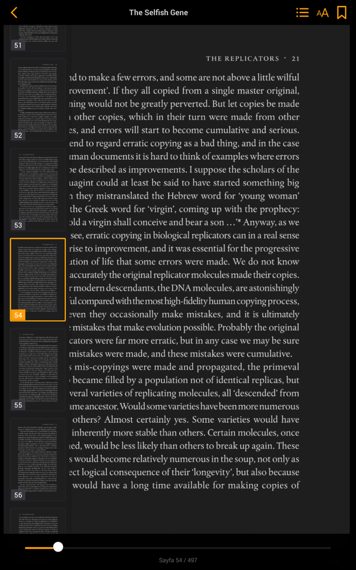

# Sayfa

**A calm, Kindle-like e-book reader for Android that turns any English word into Turkish with one tap.**

[Türkçe açıklama aşağıda ↓](#türkçe)

| Library | Tap a word | Themes and fonts | PDF, night theme |
|---|---|---|---|
|  |  |  |  |

## Why I built it

I read a lot of English non-fiction, and the hard part was never the grammar: it was the advanced vocabulary.
Stopping to look up words in another app breaks the flow every time. I also had an old Android tablet that was
too slow for anything modern but still had a great screen.

So I built Sayfa: a professional-feeling reading app that turns an old Android tablet into a dedicated e-reader,
the way a Kindle feels, where tapping any word shows its Turkish meaning straight away, even offline.

## Features

- **Tap a word, see the Turkish meaning.** An offline English → Turkish dictionary of about 63,000 words is built in.
  It understands inflected forms (*understood* → *understand*, *running* → *run*) and words split across lines.
- **Translate the whole sentence** with one button when a word alone is not enough (needs internet).
- **Kelimelerim (My Words):** save words together with the sentence you found them in, and review them later.
- **EPUB and PDF.** PDFs keep their original typography; EPUBs are laid out as real pages with proper hyphenation.
- **Remembers your place** in every book and shows how far you are on the library shelf.
- **Page overview panel** with small pictures of the pages, so you can jump around quickly.
- **Comfortable reading:** four themes (Original, Sepia, Calm, Night), adjustable text size, three book fonts,
  two-page spreads in landscape, volume-key page turning and read-aloud.
- **Runs on old hardware:** Android 4.4 KitKat and newer, no Google Play services needed, a 9 MB app.

## Install

1. Download the latest `Sayfa-*.apk` from the [Releases](https://github.com/Kadd0/sayfa/releases) page.
2. On the tablet, allow installing apps from unknown sources and open the APK.
3. Copy your `.epub` and `.pdf` files into a folder named **Kitaplar** (or `Books`, `Download`, `documents`).
4. Open Sayfa. Your books appear on the shelf.

## Privacy

Sayfa has no accounts, no ads, no analytics and no tracking. Books, reading positions and saved words stay on the
device. The internet is used for one thing only: when you press **Cümleyi Çevir** (translate sentence), that one
sentence is sent to Google Translate's web endpoint, or to [MyMemory](https://mymemory.translated.net/) if Google
does not answer. Book pages themselves are blocked from using the network.

## Build from source

Requirements: JDK 17 or newer and the Android SDK (platform 36). Android Studio provides both.

```bash
./gradlew assembleDebug
```

The APK is written to `app/build/outputs/apk/debug/`. Install it with `adb install -r <apk>`.

For a signed release build, create `keystore.properties` in the project root (it is git-ignored) and run
`./gradlew assembleRelease`:

```properties
storeFile=C:/path/outside/the/repo/release.jks
storePassword=...
keyAlias=sayfa
keyPassword=...
```

### Rebuilding the dictionary

`app/src/main/assets/dict.db` is generated by [`tools/build_dict.py`](tools/build_dict.py) from WikDict and FreeDict.
The script's header lists where to download both sources.

## How it works

| Part | Where |
|---|---|
| Library, reading screens, word card, settings | `app/src/main/java/io/github/kadd0/sayfa/` |
| EPUB page layout, hyphenation, word taps | `app/src/main/assets/reader.js`, `hyph.js` |
| PDF pages and page previews (PDF.js) | `app/src/main/assets/pdf.html`, `pdfview.js` |
| Offline dictionary lookups | `Dict.java` + `assets/dict.db` (SQLite) |

The app is plain Java with no third-party Android libraries, so it stays small and fast on 2 GB tablets.
Books are rendered in the system WebView: EPUB chapters are laid out in CSS columns, PDFs are drawn by PDF.js.

## Contributing

Issues and pull requests are welcome. Please keep the app working on Android 4.4 and run
`./gradlew testDebugUnitTest lintDebug` before sending a change (lint warnings fail the build).

## License

Sayfa is free software, released under the [GNU General Public License v3.0 or later](LICENSE).
It includes PDF.js, Hypher, the Literata and Crimson Text fonts and dictionary data from WikDict and FreeDict;
see [THIRD_PARTY_NOTICES.md](THIRD_PARTY_NOTICES.md) for their licenses.

---

## Türkçe

**Sayfa, eski bir Android tableti Kindle gibi bir e-kitap okuyucusuna dönüştüren, dokunduğun İngilizce kelimenin
Türkçesini anında gösteren bir okuma uygulaması.**

### Neden yaptım?

Zor olan gramer değil, ileri seviye kelimelerdi; her seferinde başka bir uygulamaya
geçip kelime aramak okumanın akışını bozuyordu. Bir de artık yavaşladığı için kullanmadığım ama ekranı hâlâ çok iyi
olan eski bir Android tabletim vardı.

Ben de Sayfa'yı yaptım: eski tableti Kindle gibi sadece okumaya ayrılmış, profesyonel hissettiren bir okuyucuya
çeviren, herhangi bir kelimeye dokununca Türkçesini internet olmadan bile hemen gösteren bir uygulama.

### Özellikler

- **Kelimeye dokun, Türkçesini gör:** yaklaşık 63.000 kelimelik çevrimdışı İngilizce → Türkçe sözlük.
  Çekimli halleri (*understood* → *understand*) ve satır sonunda bölünmüş kelimeleri tanır.
- **Cümleyi Çevir:** gerektiğinde bütün cümleyi tek tuşla çevirir (internet gerekir).
- **Kelimelerim:** kelimeleri bulduğun cümleyle birlikte kaydet, sonra tekrar et.
- **EPUB ve PDF desteği**, kaldığın sayfayı hatırlama, raftaki her kitap için okunma yüzdesi.
- **Sayfa önizleme paneli**, dört tema (Orijinal, Sepya, Sakin, Gece), yazı boyutu, üç kitap fontu,
  yatayda çift sayfa, ses tuşlarıyla sayfa çevirme ve sesli okuma.
- **Eski cihazlarda çalışır:** Android 4.4 ve üstü, Google Play hizmetleri gerekmez.

### Kurulum

1. [Releases](https://github.com/Kadd0/sayfa/releases) sayfasından en son `Sayfa-*.apk` dosyasını indir.
2. Tablette bilinmeyen kaynaklardan uygulama yüklemeye izin ver ve APK'yı aç.
3. `.epub` ve `.pdf` dosyalarını tabletteki **Kitaplar** klasörüne kopyala.
4. Sayfa'yı aç; kitapların rafta görünür.

### Gizlilik

Hesap, reklam, analiz ya da takip yok. Kitaplar, kaldığın yerler ve kaydettiğin kelimeler cihazda kalır.
İnternet yalnızca **Cümleyi Çevir** tuşuna bastığında, o cümleyi çevirmek için kullanılır.

### Lisans

Sayfa özgür yazılımdır ve [GNU GPL v3.0 (veya sonrası)](LICENSE) lisansıyla yayınlanır.
